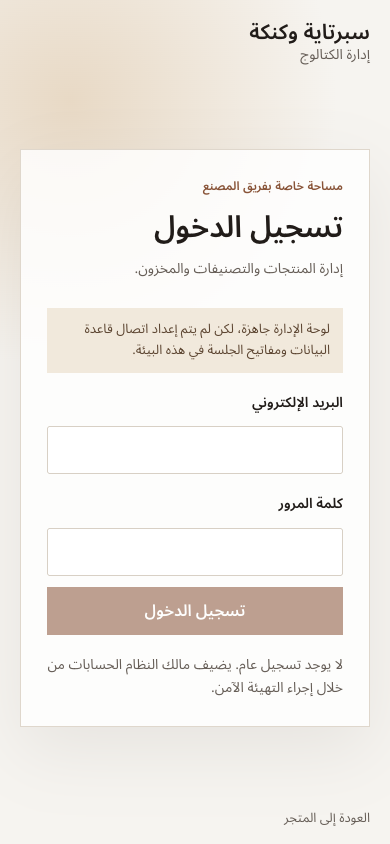
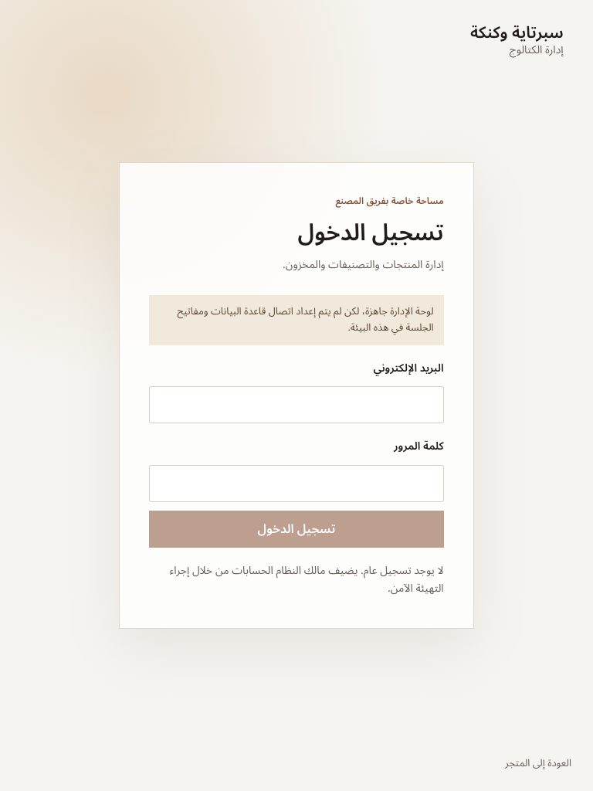
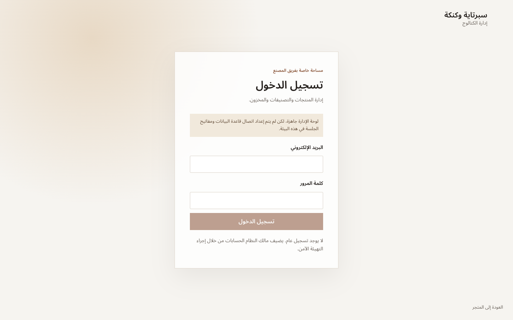

# Sprtaya & Kanaka — Phase 2 Implementation Report

**Status: PARTIAL**  
**Reviewed:** 27 October 2026

The MySQL/MariaDB catalog and Arabic administration foundation is implemented locally. TypeScript, lint, unit tests, schema validation, the production build, and the production browser/accessibility suite pass. Phase 2 is not accepted end to end because no local or staging database, Hostinger credentials, or persistent media bucket is available in this workspace. Authentication, database-backed CRUD, inventory transactions, import application, and durable uploads therefore remain unverified. No production deployment or database write was made.

## Starting state and scope

- The workspace root has no `.git` entry, so a starting commit, branch, and clean/dirty Git status could not be established. The installed Git command also could not run because Apple Command Line Tools are absent. Changes are present in the local workspace; no commit or push was made.
- The existing Phase 1 storefront, local product/catalog data, routes, and extracted image archive were preserved. The archive was not deleted or altered.
- No Phase 3, checkout, payment, orders, customer accounts, production deployment, or change to the original factory website was made.
- Relevant instructions used: Design Taste Frontend, React Best Practices, and Web Interface Guidelines. Browser validation used the repository Playwright/axe harness.

## Architecture delivered

- **Database:** Prisma 7 with the MySQL provider, `@prisma/adapter-mariadb`, a bounded connection pool, and a checked-in initial migration at [`prisma/migrations/20261027000000_phase2_initial/migration.sql`](prisma/migrations/20261027000000_phase2_initial/migration.sql). The schema at [`prisma/schema.prisma`](prisma/schema.prisma) covers administrator roles and permissions, sessions/accounts, products and variants, localized catalog fields, categories and associations, media, inventory balances and movements, manufacturing policies, store settings, audit events, legacy mappings, and import issues. Prices use integer minor units; inventory has non-negative constraints and adjustment records.
- **Authentication and authorization:** Better Auth is configured for database-backed staff accounts with public sign-up disabled, session handling, login rate limiting, and forced first-password change. Server-side permission checks cover protected pages, actions, and media endpoints. The role matrix is in [`src/lib/admin/permissions.ts`](src/lib/admin/permissions.ts): OWNER has all permissions; MANAGER has catalog, inventory, settings-read, and audit-read permissions; CATALOG_EDITOR has catalog/category/media permissions; INVENTORY_STAFF has inventory read/adjust permissions. Owner creation is an explicit interactive bootstrap, not a default password.
- **Admin:** Arabic-first `/admin` pages cover overview, products, categories, inventory, settings, staff, and audit history, with product/variant editing, publication gates, inventory actions, and first-password-change flow. These routes are present in the production build. Their database-backed behavior was not exercised without a database.
- **Storefront:** `CATALOG_SOURCE=mysql` selects request-time database reads; local catalog remains the default preview mode. Database-backed public reads are limited to published products and visible/reviewed categories. Existing Arabic/English routes and search/filter navigation remain available. Product copy remains Arabic until reviewed English translations are supplied.
- **Media:** New uploads use short-lived signed S3-compatible uploads, server-side validation/finalization, original preservation, a 1920px WebP display derivative, and upload audit metadata. No bucket or credentials are configured. Imported legacy images still reference the local archive and must be copied to durable storage before a deployed database catalog can serve them.
- **Setup:** [`docs/phase-2-setup.md`](docs/phase-2-setup.md) documents local/staging environment variables, migration, seed, owner bootstrap, catalog review, storage, and rollout prerequisites. `.env.example` contains placeholders only.

### Hostinger compatibility review

Hostinger’s current documentation says Web and Cloud plans use MariaDB and that the Node.js database host should be `127.0.0.1` with a MySQL URL; the application uses that connection convention. Hostinger currently supports Node 22 and 24, both within the project’s `>=22 <25` engine range. Its Node.js limits page lists Business/Unlimited plans, but the purchased account, actual entitlement, runtime, resource limits, and database version were not inspected. Confirm the plan in hPanel and check the database version there before migration. Hostinger documents deployment-managed build paths as overwritten by deployments, so this implementation does not store new uploads there; a separate object-storage bucket is required for durable owner media.

- [Hostinger: database system and connection details](https://www.hostinger.com/support/1583226-which-database-management-system-is-used-at-hostinger/)
- [Hostinger: connecting a Node.js application to its database](https://www.hostinger.com/support/connecting-a-hostinger-mysql-database-to-a-node-js-application/)
- [Hostinger: Node.js plan limits](https://www.hostinger.com/support/hostinger-node-js-limits-for-web-and-cloud-plans/)
- [Hostinger: deployment-managed Node.js files](https://www.hostinger.com/support/how-to-deploy-a-nodejs-website-in-hostinger/)
- [Hostinger: checking the actual MariaDB version](https://www.hostinger.com/support/how-to-check-your-database-version-in-phpmyadmin-at-hostinger/)

## Legacy catalog dry run

The importer is idempotent by source identifiers and has an explicit local/staging-only apply guard. Its latest read-only dry run found:

| Record                                                      |         Count |
| ----------------------------------------------------------- | ------------: |
| Source products                                             |           487 |
| Source categories / currently mapped categories             |       38 / 36 |
| Unique archived images / gallery references                 | 1,752 / 2,823 |
| Products with / without downloaded images                   |       487 / 0 |
| Missing archived image files / unmapped category references |         0 / 0 |
| Source rows containing price evidence                       |           487 |
| Operational prices imported                                 |         **0** |
| Products prepared as drafts                                 |           487 |

This was a dry run only: it read manifests and local file metadata, did not connect to or write to a database, and did not import images to object storage. Source price evidence is not treated as a verified operational price; imported products remain drafts with unavailable status and no operational price/type until reviewed.

## Validation results

| Check                                                                   | Result                                                                           |
| ----------------------------------------------------------------------- | -------------------------------------------------------------------------------- |
| TypeScript (`tsc --noEmit`)                                             | **PASS**                                                                         |
| ESLint (`eslint .`)                                                     | **PASS**                                                                         |
| Unit tests (`vitest run`)                                               | **PASS — 10 tests in 3 files**                                                   |
| Prisma schema (`prisma validate`)                                       | **PASS** with a non-secret placeholder URL; no database connection was attempted |
| Production build (`next build --webpack`, `NEXT_DIST_DIR=.next-phase2`) | **PASS**; storefront, all admin routes, auth and media routes built              |
| Production browser checks (`scripts/browser-qa.mjs`)                    | **PASS — 39/39 checks**                                                          |
| axe accessibility audits                                                | **30 audits, 0 violations, 0 incomplete results**                                |
| Browser errors / failed responses / horizontal overflow / broken images | **0** in the recorded browser run                                                |

Browser checks covered Arabic and English routes, homepage rendering at 390/768/1440px, search, empty-search recovery, category filtering, sorting and pagination, locale switching, product gallery, cart/account informational states, mobile navigation, reduced motion, no-script navigation, and not-found recovery. The browser report and its route screenshots are in [`docs/phase-2-screenshots/browser-qa/`](docs/phase-2-screenshots/browser-qa/). Two visual review passes were completed; the final Playwright pass captured the built production preview.

### Storefront screenshots

| Locale  | 390px mobile                                      | 768px tablet                                      | 1440px desktop                                     |
| ------- | ------------------------------------------------- | ------------------------------------------------- | -------------------------------------------------- |
| Arabic  | [Screenshot](docs/phase-2-screenshots/ar-390.png) | [Screenshot](docs/phase-2-screenshots/ar-768.png) | [Screenshot](docs/phase-2-screenshots/ar-1440.png) |
| English | [Screenshot](docs/phase-2-screenshots/en-390.png) | [Screenshot](docs/phase-2-screenshots/en-768.png) | [Screenshot](docs/phase-2-screenshots/en-1440.png) |

### Admin screenshots

These are the responsive **sign-in screen** at 390px, 768px, and 1440px. They are not evidence of a signed-in dashboard session; the database and administrator credentials were unavailable.

## Acceptance status and remaining work

**Phase 2 acceptance recommendation: PARTIAL.** Code and offline validations are in place, but the following acceptance criteria require infrastructure before they can be marked complete:

1. Provision an isolated local or staging MariaDB compatible with the migration; check its exact version, apply the migration, seed roles, and verify backup/restore.
2. Bootstrap the owner; test sign-in, logout, session expiry/revocation, forced password change, rate limiting, and every role’s server-side authorization.
3. Exercise product/category CRUD, publish/archive gating, unique SKUs, transactional inventory adjustments, concurrent updates, negative-stock protection, manufacturing settings, and audit records against that database.
4. Apply the importer to staging; verify idempotent reruns, created draft counts, relationships, image mapping, and recorded failures. Review product/category copy, variants, prices, types, inventory, and publishability before public reads.
5. Create a restricted S3-compatible bucket, configure exact-origin CORS, test signed upload/finalization/read-back and persistence across redeploys, and migrate the 1,752 legacy image objects before enabling the database catalog in a deployed app.
6. Confirm Hostinger hPanel plan entitlement, Node version, MariaDB version, environment-variable configuration, database connectivity, backups, resource limits, and app restart/build behavior. No Hostinger deployment was attempted.
7. Verify the listed factory number is usable for voice contact before launch; the code retains the existing `+20 1142800111` contact and does not invent another number.

No checkout, payments, orders, customer accounts, quotation forms, or Phase 3 work are included. The implementation should remain in preview mode until the above staging checks pass.
