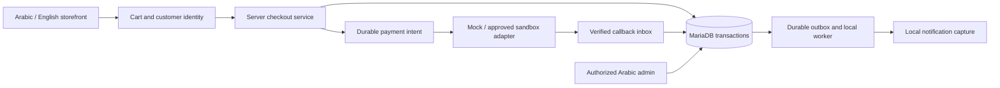

# Phase 3 architecture and implementation plan

**Status: M0 PARTIALLY APPROVED for planning. Implementation and database execution remain PENDING.**

Prepared 29 October 2026; updated with the Product Owner's explicit M0 planning decisions. This deliverable changes documentation only. The [decision register](phase-3-owner-decisions.md) distinguishes approved planning rules from unresolved operating terms. The [bounded implementation proposal](phase-3-product-decision-review.md) is not execution authorization. No schema/migration application, database write, gateway, customer account, order, external service or deployment is initiated.

## Approved M0 design requirements and precedence

1. NEW made-to-order templates default to DEPOSIT/PERCENT/50 at the future template/application layer, with product-level overrides. Do not change the Prisma/database default, convert any existing FULL_ADVANCE policy, backfill existing products or alter the 487 drafts, prices, stock, users or other existing records. Existing editors and missing-policy paths must not infer 50% for an existing product; only an explicitly new template receives that preference. Existing policies retain their meaning.
2. Ready-to-ship products alone are potentially COD-eligible. Made-to-order deposits AND outstanding balances are currently COD-ineligible. Product overrides, stored legacy codBalanceEligible flags or available interfaces cannot broaden that approved restriction. Preserve legacy records while the future eligibility service denies the unsupported method.
3. InstaPay and mobile wallets have both manual reconciliation and future automated gateway paths. Claims are not paid receipts: verified reconciliation is required before order credit. No receiving instructions, provider selection or external activation is authorized.
4. Specifically authorized managers may receive explicit bounded financial grants alongside the owner. A MANAGER role never implies unrestricted authority. Define limits and self-approval prevention before implementation; separate request, approval, execution and reconciliation with audit.
5. Deposits and outstanding balances remain separate obligations. No automatic deposit forfeiture. No payable amount may be calculated without defined currency, tax, discount, shipping and rounding rules plus reviewed product and payment/fulfillment terms. Missing configuration is not zero/free.

Approval precedence is: hard safety/approved eligibility restrictions → complete approved operating policy → permitted product override → availability toggle. A lower layer cannot override a denial or supply missing approval. These are planning/design constraints, not implementation permissions.

## 1. Evidence and constraints

The current implementation was inspected, rather than relying on older roadmap proposals:

| Inspected evidence                                                                                                                           | Consequence for Phase 3                                                                                                                                                                                         |
| -------------------------------------------------------------------------------------------------------------------------------------------- | --------------------------------------------------------------------------------------------------------------------------------------------------------------------------------------------------------------- |
| [Phase 2 acceptance](phase2-local/acceptance.md) and its browser/runtime evidence                                                            | Recorded baseline: 101 passing tests, including 20 real database/storage tests; local acceptance passed. These were not rerun for this documentation task.                                                      |
| [Prisma schema](../prisma/schema.prisma), both migration SQL files                                                                           | Staff identity, catalog, variants, on-hand inventory, manufacturing policies and audit records exist. Customer, cart, reservation, order, payment and shipment tables do not.                                   |
| [Staff auth](../src/lib/server/auth.ts), [session guard](../src/lib/server/admin-session.ts), [permissions](../src/lib/admin/permissions.ts) | Better Auth is configured specifically for AdminUser, with public signup disabled. Public registration must never use this staff realm.                                                                         |
| [Inventory and admin actions](../src/app/admin/actions.ts)                                                                                   | Quantity adjustments use transactional version checks and unique request keys. There is no reservation counter; automatic inventory movements currently require a staff actor. Both need deliberate extensions. |
| [Storefront catalog](../src/lib/server/storefront-catalog.ts)                                                                                | Published/visible/reviewed records are selected, but every product still returns purchasable=false. Source-display IDs may differ from internal UUIDs; cart references must use actual internal variant IDs.    |
| [Money helpers](../src/lib/money.ts), [publication checks](../src/lib/admin/product-publication.ts)                                          | Prices use exact minor units; current publication permits zero prices and does not establish checkout eligibility. A separate purchasing rule is required.                                                      |
| [Local runbook](phase2-local/README.md)                                                                                                      | MariaDB 11.8.9 and filesystem-backed S3 work locally. All 487 genuine products remain drafts without operational prices. No automatic pricing, stock assumptions or mass publication is permitted.              |

Preserve Next.js 16.4.3, React, Prisma 7.10.1, the MariaDB adapter, Better Auth 1.7.14, the approved storefront design, Arabic RTL and English LTR. No framework replacement, microservice split, new paid infrastructure, wholesale quotation platform or dependency upgrade is proposed.

Hostinger routing is a separate workstream. No Hostinger API, deployment, DNS, database or environment mutation is part of Phase 3 local development. Existing staging access protection remains mandatory.

## 2. Architecture and reuse

Continue the modular monolith: Next.js Server Components for reads, Server Actions for browser mutations, and Node Route Handlers for auth and payment callbacks. Put authoritative logic in server-only services shared by these entry points. Return narrow DTOs; do not pass ORM records containing customer PII or financial metadata to generic client components.

Proposed boundaries:

| Module                        | Responsibility                                                                                                               |
| ----------------------------- | ---------------------------------------------------------------------------------------------------------------------------- |
| Customer identity             | Separate Better Auth instance, profile, verification, recovery, addresses and customer ownership checks                      |
| Cart                          | Opaque guest cart cookie, signed-in cart ownership, quantity edits, merge and current availability                           |
| Checkout/pricing              | Authoritative eligibility, address/shipping quote, immutable order snapshots, installment schedule and idempotent submission |
| Inventory                     | Holds, confirmed allocations, expiry, dispatch consumption and received-return restocking                                    |
| Orders/production/fulfillment | Explicit commands and guarded state transitions; immutable history                                                           |
| Payments                      | Provider adapters, attempts, settlement entries, allocation, reconciliation and refunds                                      |
| Notifications/jobs            | Transactional outbox/inbox, bounded retries, leases and local capture adapters                                               |
| Admin commerce                | Reuse AdminFrame, permission guard, Arabic forms, money formatting and audit patterns                                        |

Suggested locations are src/lib/server/commerce/*, src/lib/server/customer-auth.ts, src/lib/server/customer-session.ts and corresponding localized routes. Keep Prisma access and secrets server-side. Existing catalog/admin code will call shared inventory services once reservations exist; leaving the old adjustment path able to consume reserved stock would violate the design.

For the initial implementation, a dedicated local worker command processes database jobs. Do not rely on request completion, in-memory timers, a browser tab, or fire-and-forget promises. Redis is not required. A future hosted worker/scheduler is a separate deployment prerequisite.

## 3. Proposed schema changes

These are model specifications, not executable Prisma models or migration SQL. Preserve the two Phase 2 migrations unchanged and add reviewed, forward-only migration stages after approval.

### Customer identity and cart

| Proposed models                                                                                         | Fields, ownership and constraints                                                                                                                                                                                                                                                 |
| ------------------------------------------------------------------------------------------------------- | --------------------------------------------------------------------------------------------------------------------------------------------------------------------------------------------------------------------------------------------------------------------------------- |
| CustomerUser, CustomerAuthSession, CustomerAuthAccount, CustomerAuthVerification, CustomerAuthRateLimit | Better Auth-compatible dedicated models; normalized unique email within the customer realm, opaque sessions, hashed credentials and verification state. No staff role field or relation.                                                                                          |
| CustomerAddress                                                                                         | Customer FK, recipient, normalized phone, ISO country, stable governorate/region and locality identifiers, address lines, building/unit, delivery notes, optional postal code where appropriate. Separate default shipping/billing preference; changes never rewrite past orders. |
| Cart, CartItem                                                                                          | Nullable customer FK or hashed random guest token, version/expiry, variant UUID and positive bounded quantity; unique cart+variant. No authoritative client price. Merge atomically after login, cap quantities and report conflicts.                                             |
| CheckoutSession, IdempotencyRecord                                                                      | Actor/cart identity, cart version, quote hash, expiry, request-body hash, operation-scoped unique key and resulting order. Same key+body returns the same result; a changed body conflicts.                                                                                       |
| GuestOrderAccessGrant                                                                                   | Order-bound hashed high-entropy token, expiry/revocation and single-use exchange state. Sequential order number/email alone never grants access.                                                                                                                                  |

Reuse Better Auth with a different base path (/api/customer-auth), customer-only model names, a distinct cookie prefix and a separate customer secret. Preserve existing staff routes/cookies. Same email may exist in each realm without linking permissions. Use database-backed rate limits and adapter transactions for customer credential/reset operations; the installed 1.7.14 Prisma adapter exposes the transaction option.

Review any auth-generated schema with tooling matched to the pinned version; do not run an unpinned auth CLI over the existing schema or apply its output automatically. Confirm customer email/reset callbacks and database transaction behavior in M2 before claiming atomic recovery.

### Inventory and order records

| Proposed additions                            | Purpose and constraints                                                                                                                                                                                                                                                                                                                              |
| --------------------------------------------- | ---------------------------------------------------------------------------------------------------------------------------------------------------------------------------------------------------------------------------------------------------------------------------------------------------------------------------------------------------- |
| InventoryBalance.reservedQuantity             | Default zero; database CHECK: quantity >= reservedQuantity >= 0. Existing quantity retains its meaning as physical on-hand stock.                                                                                                                                                                                                                    |
| StockReservation, ReservationEvent            | Variant/balance, order item, quantity, HELD/COMMITTED/CONSUMED/RELEASED state, hold expiry, version and unique operation keys. Immutable reserve/release/consume history.                                                                                                                                                                            |
| InventoryMovement extensions                  | Reservation delta/after balance, order/reservation reference and reserve/release/dispatch/return kinds; nullable staff actor plus ADMIN/CUSTOMER/SYSTEM/PROVIDER kind. New isolated synthetic fixtures can set explicit actor/reservation data. No existing Phase 2 row backfill is authorized. Never invent a staff user for system work.           |
| Order, OrderItem                              | Internal UUID and unique display number; nullable customer ownership, contact/locale/address snapshots, original totals/currency, shipping/payment policy versions, separate lifecycle state and optimistic version. Lines snapshot internal product/variant IDs, SKU, reviewed names/options, quantity, unit price and manufacturing/deposit terms. |
| OrderInstallment                              | Order/line allocation, INITIAL/BALANCE purpose, amount, due trigger, collection method and immutable terms. Settlement is derived from allocations, not a staff-editable paid flag.                                                                                                                                                                  |
| OrderEvent, OrderAdjustment                   | Append-only transitions, reason, actor kind/reference and operation key; approved commercial credits for cancellations, returns or corrections. Never rewrite original order prices to make a refund balance work.                                                                                                                                   |
| ManufacturingWorkOrder                        | Made-to-order line, approved standard variant/options snapshot, quantity, policy version, estimated lead-time window and production state. No wholesale/custom-design upload form.                                                                                                                                                                   |
| Shipment, ShipmentItem, ShipmentEvent, Return | Explicit line quantities, approved address snapshot, carrier/tracking reference, dispatch/delivery/failed-delivery state, returned/inspected/restocked quantities. Start with one shipment per order; do not silently create partial shipments.                                                                                                      |

Retain financial/order history when catalog records are archived. New order references use Restrict or nullable snapshot-backed relations, not cascading order deletion. An address/profile deletion may anonymize eligible customer records without erasing retained order evidence; the retention policy needs approval.

### Payments, configuration and delivery

| Proposed models                                 | Purpose and uniqueness                                                                                                                                                                                                                                                        |
| ----------------------------------------------- | ----------------------------------------------------------------------------------------------------------------------------------------------------------------------------------------------------------------------------------------------------------------------------- |
| PaymentAttempt                                  | Installment, method, MOCK/SANDBOX mode, expected amount/currency, durable merchant reference, provider account, attempt state, provider transaction reference, idempotency key and reconciliation timestamps                                                                  |
| SettlementEntry, PaymentAllocation              | Immutable verified receipts/reversals and allocation to installments; unique source operation/provider transaction prevents duplicate credit. Manual methods record verification actor/reference, not a screenshot-derived success.                                           |
| PaymentEventInbox                               | Provider/account/mode plus event identity or canonical digest, signature verification result, protected payload reference, processing state, attempts and retry lease                                                                                                         |
| Refund, RefundEvent                             | Payment/settlement allocation, amount, reason, approval, idempotency, external reference and independent request/result states; uncertainty remains explicit                                                                                                                  |
| FinancialAuthorityGrant, FinancialApproval      | Proposed named-manager operation/currency/amount/aggregate caps, validity/revocation and owner approval; immutable financial request/approval/execution/reconciliation references. No role-wide or unbounded default grant. Exact limits/separation rules remain D11 PENDING. |
| ShippingZone, ShippingRate, PaymentMethodPolicy | Versioned owner-approved destinations, rate rules, method eligibility, COD limits and collection rules. No default real fees or destinations.                                                                                                                                 |
| CommercePolicyVersion                           | Immutable approved snapshot of currency, tax/invoice treatment, expiry, cancellation/return, production and shipping policies                                                                                                                                                 |
| OutboxMessage, JobRun, NotificationDelivery     | Unique event/channel/template/recipient deduplication key, locale, retry/lease/dead-letter state and delivery reference; separate operational notifications from marketing consent                                                                                            |

Add indexes for customer+createdAt, order state+createdAt, balance/state/expiry, provider references, inbox processing and job due times. Use bounded strings/enums and database uniqueness/FKs/CHECKs where supported. Cross-row financial invariants still require locked transactions and reconciliation tests.

Financial totals should use signed BIGINT minor units for new commerce models with bounded business limits and explicit string/BigInt serialization. Existing bounded product Int prices can remain. Never round via binary floating point or expose raw BigInt through JSON. EGP is the proposed initial settlement currency; English language does not imply another currency.

## 4. Customer and checkout flows

### Identity and account

Provide localized register, login, email verification, password reset/change, profile, saved-address and order-history screens. Reuse the existing visual language and header controls. Public customer signup never enables staff signup. Require verified email before account order history or guest-order claiming; registration does not auto-claim orders by a typed email.

Reauthenticate for sensitive email/password changes, verify a replacement email before activating it, revoke sessions as appropriate, and return non-enumerating recovery responses. Customer-facing navigation, validation and transactional copy must be reviewed in both languages; preserve original Arabic product content with language annotations where reviewed English product translations do not exist.

Proposed guest checkout collects recipient, email and phone without creating an account. Issue an order-scoped HttpOnly viewing session; recovery uses a short-lived, hashed, one-time email-link exchange. A link GET must not mutate order/payment state or consume a token merely because an email scanner visited it. Exchange through a protected POST, suppress referrers/query logging, and use private/no-store responses. Claiming an existing guest order requires verified customer ownership plus the order-access challenge.

Local verification/recovery and transactional messages go only to a private capture adapter. No real email/SMS/WhatsApp messages or paid sender are provisioned in this phase without a later approved configuration.

### Cart and quote

1. Add an active internal variant of a published, reviewed, purchasable product. Unknown prices/types, hidden categories, unreviewed data, zero-price items without an explicit approved free-item policy, inactive variants and unavailable manufacturing are rejected.
2. Quantity controls show current availability; cart contents alone do not reserve stock. Persist only IDs/quantities and reprice on the server.
3. On country/address selection, load an approved eligible shipping rate and compatible payment methods. Use stable zone IDs; normalize Arabic digits and phone inputs without altering customer names.
4. Return a short-lived quote with item/subtotal/shipping/tax/total, payment due now/later, stock warnings and policy version. A changed price, fee, address, cart or policy requires a new quote and explicit customer confirmation.
5. Submit once with an idempotency key. Revalidate everything and reserve/create the order atomically; do not trust the quote as an unlimited guarantee.

There must be no checkout path through the archive-only preview catalog. CATALOG_SOURCE=mysql, explicit commerce enablement and approved product/rate/payment policy are required. Keep all 487 genuine products unpurchasable until their own data is approved.

### Egypt and international eligibility

Egypt-first checkout uses country, governorate, city/district, street, building/unit, recipient phone and optional delivery directions/postal code as the chosen carrier requires. Do not guess a nationwide price or assume every district is deliverable.

International ordering is supported through an explicit country/rate/product allowlist and prepaid methods supported by the chosen merchant account. Proposed default: no international COD, no Egypt-only wallet/InstaPay assumption, and full payment including shipping before dispatch. Missing approved rates, missing required weight/dimensions for a weight-based rule, or carrier/product restrictions block checkout and offer factory telephone contact. There is no international or wholesale quotation portal.

For the first release, recommend allowing mixed carts but requiring separate ready-made and made-to-order checkouts with clearly disclosed separate shipping. Do not silently split or charge twice. A combined-shipment alternative requires owner approval because it ties up ready stock throughout manufacturing.

### Deposits and balances

Snapshot each product's existing ManufacturingPolicy without changing it. FULL_ADVANCE still requires full line payment. Only NEW made-to-order templates receive the approved 50% template preference, with overrides; this does not authorize calculating a deposit or rewriting stored policies. DEPOSIT uses the subsequently approved percentage/fixed basis. Fixed deposits per unit and ceiling percentage rounding per line remain recommended D6 rules, not approved operational settings.

Before any merchant amount calculation, require an approved complete currency/tax/discount/shipping/rounding policy. An explicit approved DISABLED discount policy may produce zero discount; a missing rule may not. Missing tax is not exemption, missing shipping is not free shipping, and 50% alone cannot produce a payable amount.

Candidate accounting relationship for a prepaid made-to-order checkout, usable only after its basis and collection timing are approved:

    initial merchandise due = sum(full-payment lines + calculated deposit lines)
    initial due = initial merchandise due + approved shipping + applicable tax due now
    later balance = approved order total - initial due

The owner must approve tax/discount basis, shipping/tax collection, currency, rounding and balance deadlines; none is inferred. An eligible ready-to-ship COD schedule may have zero due now only after its complete D4/D7/D9/D11 rules are approved. Manufacturing deposits and balances are HARD DENIED COD under the current planning approval, even if a legacy product policy says otherwise. Balance before dispatch remains the recommendation, not a finalized deadline.

Track initial deposit and later balance as separate installments with separate receipt allocations, due triggers and collection state. Never label a deposit as full settlement or automatically forfeit it on cancellation/expiry; D10 determines eligibility and any commercial credits after review.

The quote must expose net/tax/gross components consistently. The “applicable tax due now” term adds only tax not already included in the calculated line/shipping amounts; tax-inclusive prices must never be taxed twice. No real tax rate or invoice treatment is set by this plan.

Production starts only after confirmed required initial funds and owner acceptance. Display “received, awaiting payment review” for manual payment and “balance outstanding” for a deposit; never label a deposit as fully paid.

## 5. Stock and transaction safety

Definitions:

    onHand = InventoryBalance.quantity
    allocated = reservedQuantity for HELD or COMMITTED reservations
    sellable = onHand - allocated
    0 <= allocated <= onHand

An expired HELD row remains conservatively allocated until released in a transaction. Before a new checkout allocates a variant, release its eligible expired holds under the same lock. A worker also reaps holds. Read-side expiry alone must never free stock without updating the counter/history.

Proposed transitions:

| Reservation transition                                     | Stock effect                                                      |
| ---------------------------------------------------------- | ----------------------------------------------------------------- |
| Create HELD at checkout                                    | allocated += quantity; onHand unchanged                           |
| HELD → COMMITTED on funding/approved COD confirmation      | Counters unchanged; allocation no longer auto-expires             |
| HELD → RELEASED on expiry/cancel                           | allocated -= quantity exactly once                                |
| COMMITTED → RELEASED on approved pre-dispatch cancellation | allocated -= quantity exactly once                                |
| COMMITTED → CONSUMED at dispatch                           | onHand -= quantity and allocated -= quantity atomically           |
| Received/inspected return → restock                        | onHand += accepted quantity once; never triggered by refund alone |

Use one locking convention across commerce commands: idempotency/operation record, affected orders ordered by UUID, their payment/installment/refund rows ordered by UUID, inventory balances ordered by variant UUID, then reservation rows ordered by UUID. Expiry/reconciliation workers and Phase 2 inventory mutations must use the same convention when touching the same aggregates. Revalidate rows after locks and retry if a newly discovered dependency requires restarting the lock sequence.

Use short Prisma interactive transactions, explicit tested isolation, parameterized SELECT FOR UPDATE and guarded version/counter updates. Start with Serializable for cross-row commerce commands, bounded deadlock/conflict retries with jitter and the same operation key. Validate actual MariaDB adapter error mapping; do not assume every conflict arrives as one Prisma code. Do not perform provider, email or storage network calls inside these transactions.

Checkout transaction: claim actor-scoped idempotency key → lock/revalidate quote/catalog/policy and balances → release eligible expired holds → assert sellable quantities → create immutable order/items/installments/reservations → write movement/audit/outbox → commit the resulting order reference. Any failure rolls back the whole command.

Create the durable provider-attempt reference before contacting a provider. If the call times out, persist UNKNOWN and reconcile by that reference; do not create another charge blindly. Retry from the same durable reference when the provider supports it. Browser refreshes return the same order.

Proposed hold windows needing approval: 15 minutes for online checkout, 24 hours for manual transfer or COD owner confirmation, with per-identity/IP/cart limits. Production orders retain committed ready-stock allocations; made-to-order lines create work orders rather than consuming finished-goods stock.

Cancellation, expiry and payment confirmation race on the same locked order/reservation. A late success after release enters REVIEW_REQUIRED; any reacquisition needs explicit order/customer revalidation, otherwise use the approved refund process. Never resurrect a cancelled order, start production or overdraw stock automatically. Unknown external payment results require reconciliation even if a stock hold has expired.

## 6. State machines and financial invariants

### Separate lifecycle state

| Aggregate              | Allowed main progression and guards                                                                                                                                                                                                                |
| ---------------------- | -------------------------------------------------------------------------------------------------------------------------------------------------------------------------------------------------------------------------------------------------- |
| Order                  | PENDING_PAYMENT → PENDING_ACCEPTANCE → CONFIRMED → FULFILLING → COMPLETED. Unfunded requests may EXPIRE; eligible pre-dispatch orders may CANCEL. Any mismatch can enter REVIEW_REQUIRED. Payment receipt alone does not assert dispatch/delivery. |
| PaymentAttempt         | CREATED → ACTION_REQUIRED/PENDING → SUCCEEDED/FAILED/CANCELLED; AUTHORIZED is not captured money. Timeouts become UNKNOWN until verified. SUCCEEDED is not overwritten by a stale failed callback; refund/reversal are separate facts.             |
| Order payment summary  | Derived UNPAID/PARTIALLY_PAID/PAID/OVERPAID plus refund/review indicators, calculated from confirmed settlement entries and installment allocations                                                                                                |
| ManufacturingWorkOrder | WAITING_INITIAL_PAYMENT → AWAITING_ACCEPTANCE → QUEUED → IN_PRODUCTION → READY. Cancellation after production starts follows approved terms; it is not a customer-side unconditional transition.                                                   |
| Shipment               | PENDING → READY → DISPATCHED → DELIVERED, with FAILED_DELIVERY/RETURNING/RETURNED paths. COD delivery and COD collection/remittance are separate facts.                                                                                            |
| Refund                 | REQUESTED → APPROVED → SUBMITTED → SUCCEEDED, or REJECTED/FAILED/UNKNOWN. Retrying an uncertain submission reconciles the same request first.                                                                                                      |

Every transition is an explicit command with permitted source states, current version, actor/permission, policy version, reason and unique operation key. Guard state in the database update; do not accept arbitrary status strings from forms.

Eligible COD orders with zero due now enter PENDING_ACCEPTANCE directly. For prepaid orders the required initial receipt enables that transition. Customer cancellation is conditional on fulfillment/production state and the approved policy; partial returns and failed delivery retain their own line/shipment records.

### Invariants

1. Calculate merchant payable amounts only from a complete approved currency/tax/discount/shipping/rounding policy and reviewed prices/payment/fulfillment terms. Server-recompute the result; cart/browser/provider callbacks cannot set it. All values share the order currency and use bounded exact minor units. Incomplete rules return an unavailable/error result, not a numeric payable.
2. Snapshot original line amounts, options, contact/address, policies and locale. Subsequent catalog edits cannot change an accepted order.
3. Store a confirmed settlement once per provider/account/mode/source transaction. Allocate each receipt only once and never beyond its confirmed unrefunded amount. Concurrent captures/refunds lock the same financial aggregate.
4. Initial/deposit obligations must be met before confirmation/production. Dispatch requires ready lines, a valid shipment, allocated stock and all pre-dispatch obligations settled; an explicitly approved COD amount is the only permitted unpaid dispatch balance.
5. Refund requests reserve refundable capacity: confirmed refunds + active pending/unknown refund commitments must not exceed the confirmed receipt less confirmed reversals. Do not subtract prior refunds twice. Failed/rejected commitments release capacity. Unexpected external reversals are recorded truthfully and raise a reconciliation exception rather than being discarded to make a counter balance.
6. Never mutate a successful payment into “refunded.” Append a refund/reversal entry with its own evidence and state. Manual transfer/COD refunds remain pending until an authorized person verifies the actual outbound payment.
7. Distinguish commercial adjustment from money movement:

       revised payable = original total - approved commercial credits
       net received = confirmed receipts - confirmed refunds/reversals
       outstanding = max(0, revised payable - net received)
       excess to review/refund = max(0, net received - revised payable)

   A cancelled/returned line needs a commercial credit so refunding it does not incorrectly create a new debt. A duplicate-payment refund usually needs no commercial credit. Chargebacks/reversals trigger review, not an automatic recharge.

8. An order cannot be completed while required balance, refund, return or payment-uncertainty work is unresolved. Financial totals and goods movement reconcile independently.
9. Append audit/financial events and outbox messages in the same transaction as state changes. Delivery of a notification does not prove payment or fulfillment.

## 7. Payment architecture

Define one server-only provider contract: capabilities, createAttempt, getStatus/reconcile, verifyAndNormalizeWebhook, requestRefund and getRefundStatus. Capabilities declare supported methods/currencies, synchronous/asynchronous settlement, refunds, idempotency and authorization/capture behavior. Do not assume all providers support every operation.

After D3-T/D15-T implementation approval, build deterministic localhost MOCK contracts first. Any external SANDBOX provider, account/credentials or callback exposure requires separate review and approval; no gateway is selected by this plan. Paymob and Kashier remain examples only. A future approved card adapter uses hosted/tokenized checkout; the application never stores PAN, CVV, wallet PIN, bank login or InstaPay credentials.

Local/test environments must reject live provider mode and non-allowlisted payment endpoints, regardless of a browser parameter or misconfigured feature flag. Keep gateway secrets server-side in separate environment variables; missing or mismatched sandbox configuration disables that method rather than falling back to live.

| Method                   | Planned behavior                                                                                                                                                                                                                                 |
| ------------------------ | ------------------------------------------------------------------------------------------------------------------------------------------------------------------------------------------------------------------------------------------------ |
| Cash on delivery         | Ready-to-ship-only product eligibility is approved for planning. Destination/carrier/limits/fees/acceptance/collection rules remain pending; COD stays OFF. No manufacturing deposit/balance COD. Record expected/collected/remitted separately. |
| Bank transfer / InstaPay | InstaPay architecture supports manual verified reconciliation AND a future approved automated adapter. No claim auto-credits an order; no live receiving instructions. Bank-transfer scope/refund channels remain pending D5.                    |
| Mobile wallets           | Both manual verified transfer/reconciliation and future approved automated adapters are required in the architecture. No selected/active gateway, live instructions or credit from an unverified claim.                                          |
| Card                     | Selected gateway sandbox hosted checkout, server-created expected amount, verified result and provider transaction reference                                                                                                                     |

Manual confirmation needs dedicated bounded authority, actual receiving-account evidence, amount/currency/reference matching, duplicate checks and replay-safe allocation. A receipt image/claim alone cannot confirm funds. D5 still needs confirmation SLAs and outbound refund channels. Prefer reference entry without receipt uploads initially; later financial evidence storage must be private, never the public product-display bucket.

Webhook route handling: cap payload size; read bytes once; verify the selected provider's exact signature/canonicalization rules with a timing-safe comparison and test/live account; enforce freshness if the provider supplies authenticated timestamp semantics; correlate merchant reference, amount, currency and captured/authorized status; insert a deduplicated durable inbox record; then acknowledge. A worker processes it transactionally. Invalid signatures fail, database failure requests retry, duplicate verified deliveries acknowledge without repeating side effects. Different event IDs for the same financial transaction still cannot duplicate credit.

Do not use a universal raw-body HMAC recipe: signature formats differ by provider. Handle duplicate, reordered, delayed, partial-refund, reversal and unknown-reference events. A valid signature does not authorize a mismatched amount or account. Verify provider status server-to-server when the event semantics or uncertainty require it.

Local mock callbacks POST directly to localhost. Real sandbox callback acceptance later needs a separately approved reachable endpoint/tunnel; none is created now. Existing staging Basic Auth must not be disabled globally for callbacks. A future narrowly scoped webhook endpoint would authenticate provider signatures while every admin/customer mutation retains its own authorization. Hostinger's routing failure cannot be treated as a Phase 3 code problem.

## 8. Admin workflows and permissions

Extend the current Arabic console rather than replacing it:

- Orders list: search/reference, pending payment, manual review, ready to fulfill, manufacturing, outstanding balances and exception filters.
- Detail: minimal customer contact/address, immutable line/price/deposit breakdown, verified receipts vs claims, outstanding amount, production/shipment/return timelines and complete audit history.
- Explicit actions: accept/reject, confirm manually verified payment, record COD collection/remittance, start/complete manufacturing, dispatch/delivery/return, request/approve refund and retry/reconcile failures. Each presents its amount/effect and requires a reason where material.
- Settings: approved destinations/rates, COD eligibility/limits, method availability and instructions, manufacturing terms, reservation windows, notifications and policy versions. Secret values are environment-held and masked in settings.

Proposed permissions include ORDERS_READ, ORDERS_MANAGE, FULFILLMENT_MANAGE, PRODUCTION_MANAGE, PAYMENTS_READ, PAYMENTS_RECONCILE, REFUNDS_REQUEST, REFUNDS_APPROVE, REFUNDS_EXECUTE, FINANCIAL_ADJUSTMENTS_REQUEST/APPROVE/EXECUTE, FINANCIAL_AUTHORITY_MANAGE and COMMERCE_SETTINGS_WRITE. Any later implementation must update the enum, seed and runtime guard consistently, only after review. This document grants none.

Approved planning replaces the former owner-only financial recommendation with explicit delegation to specifically authorized managers alongside the owner. Keep CATALOG_EDITOR/INVENTORY_STAFF scopes unchanged. A MANAGER role alone grants no financial operation. Proposed authorization requires active account/session, explicit permission, active person/operation/currency grant, approved per-operation/aggregate caps, policy version and separation of duties. Owner/manager limits are not supplied and cannot default to unlimited.

Recommend requester != approver for owner and manager requests alike. Execution must consume the immutable approved amount/subject and record the permitted human/system executor; reconciliation is separate verified evidence. Define whether approval/execution actors must also differ, aggregate caps, grant validity/revocation and escalation before implementation. No automatic owner/self-approval bypass exists; if no distinct authorized approver is available, the operation stays blocked pending an explicit reviewed policy. Every stage has its own audit event. Until D11 rules are approved, only delegation contracts/denial test specifications may be prepared; do not implement grant issuance or financial approval/execution/reconciliation workflows on guessed terms, even behind a hidden button.

## 9. Security, privacy and notifications

Enforce server-side customer ownership and staff permissions on every page data service, action and route. Test that customer cookies cannot authenticate staff routes and staff cookies cannot impersonate customer orders. Require exact trusted origins/CSRF protection for browser mutations, secure HttpOnly host-only cookies, no credential logging, session revocation and database-backed abuse limits for signup/login/reset/checkout/payment attempts.

Rate-limit guest checkout and reservations to prevent stock starvation. Bound quantities, cart sizes, notes, upload sizes and idempotency payloads. Parameterize SQL; validate return URLs and provider destinations against configuration to prevent open redirects/SSRF. Escape customer/admin content and render no untrusted HTML.

Customer/order/checkout responses are private/no-store and excluded from search indexing. Redact PII, access tokens, payment credentials and provider signatures from logs; store only necessary protected event data under approved retention. Never import customer PII from the old site.

Transactional notifications use the order locale and reviewed Arabic/English templates for receipt, payment pending/confirmed, deposit/balance, production acceptance, dispatch, failed delivery, cancellation and refund. “Order received” must not imply accepted/paid. Messages carry no secrets or card data, and marketing consent remains separate.

Use an outbox event key and provider delivery idempotency where available. Exactly-once external email delivery is not assumed: crash-after-send can cause duplication unless supported by the sender. Retries/dead letters are visible; notification failure cannot roll back a completed payment or stock transaction. Protect any persisted verification/reset links as secrets with short retention; local capture is private storage, never public pages or console output. Auth delivery must use supported commit hooks or validate token state before delivery rather than assuming a separate email callback shares the auth transaction.

## 10. Recovery and operations

| Failure                                          | Required recovery                                                                                  |
| ------------------------------------------------ | -------------------------------------------------------------------------------------------------- |
| DB commit succeeds, process dies before response | Same idempotency key retrieves the same order; durable outbox resumes                              |
| Provider accepts charge, response is lost        | UNKNOWN blocks a fresh attempt; reconcile the durable merchant reference                           |
| Callback repeats/out of order                    | Inbox dedup plus unique settlement facts; never regress confirmed capture from a stale event       |
| Hold expiry races with payment                   | One locked outcome; reacquire stock or route late funds to review/refund                           |
| Owner adjustment would consume reserved stock    | Reject; require explicit order cancellation/reallocation first                                     |
| Refund submission times out                      | Keep refundable capacity committed; reconcile before retry/new refund                              |
| Worker crashes/restarts                          | Expiring leases, bounded retries, reconciliation and dead-letter queue; no lost durable work       |
| Goods return or COD delivery fails               | Track shipment/return and verified collection independently; restock only after receipt/inspection |
| Backup restored after external payment           | Disable new charging, reconcile provider transactions since backup before reopening                |

Back up before each approved local schema milestone, validate restore and use additive migrations/backfills. No destructive reset, db push, historical migration edit, or live down migration. Disabling checkout stops new orders but must preserve permitted reconciliation/refund processing for existing obligations.

## 11. Implementation milestones and acceptance gates

| Milestone                                     | Scope                                                                                                                                                                                                                            | Exit evidence                                                                                                                                                    |
| --------------------------------------------- | -------------------------------------------------------------------------------------------------------------------------------------------------------------------------------------------------------------------------------- | ---------------------------------------------------------------------------------------------------------------------------------------------------------------- |
| M0 — review                                   | Approve architecture and critical owner decisions                                                                                                                                                                                | Written decision record; unresolved choices remain blocked rather than coded as facts                                                                            |
| M1 — isolated schema and money/inventory core | After Pack A, draft isolated contracts/schema/migrations and synthetic policies. Only after separate E1 approval create guarded Phase 3 DBs, apply exact reviewed migrations and run seed/test writes; retain Phase 2 untouched. | Backups/restores, unchanged history, fresh apply/rerun, incomplete-policy rejection, exact amounts, concurrency and ledger conservation                          |
| M2 — customer identity/account                | Customer Better Auth realm, verification/reset capture, profile/addresses and guest order-access primitives                                                                                                                      | Realm isolation, session/reset/revocation/IDOR/CSRF/rate-limit tests; Arabic/English responsive account flows                                                    |
| M3 — cart and checkout                        | Variant selection, merge, shipping/method eligibility, quote/reconfirm, idempotent order creation/reservations; mock payments only                                                                                               | Duplicate submit, price changes, missing rates, concurrent checkout, hold expiry and zero invented catalog prices                                                |
| M4 — payments and recovery                    | Mock lifecycle, manual/COD reconciliation, deposits/balances, refunds, inbox/outbox; selected sandbox only after its own review                                                                                                  | All financial invariants under replay/races/timeouts, forged/mismatched callback rejection, same-reference recovery; genuine sandbox evidence separately labeled |
| M5 — admin order operations                   | Order/production/shipment/return dashboards, owner-friendly settings and localized notifications                                                                                                                                 | Role matrix tests; payment/stock/fulfillment audits; no unverified dispatch; worker crash/retry and capture-adapter proof                                        |
| M6 — complete local acceptance                | Full guest/member journeys, ready-made/made-to-order, domestic/international eligibility, account history, returns/refunds                                                                                                       | Production build + production-mode HTTP/browser tests at 390/768/1440 in both locales; accessibility; DB backup recovery; Phase 2 regression suite preserved     |

Run Phase 3 in a separate source checkout/reviewed snapshot, local app/configuration, generated-client/build paths and port (for example 3003), retaining the working Phase 2 snapshot/preview on 3002. Separate environment/build names alone do not isolate shared source or generated Prisma files. Reuse reviewed code/assets without copying private Phase 2 credentials or altering the original asset archive. Extend local tooling only through an explicit Phase 3 target allowlist; never widen guards to unknown hosts/names. No checkout/snapshot or database is created by this document.

Each milestone receives a short PASS/PARTIAL/FAIL report with executed commands, real DB/provider vs mocked evidence, screenshots where relevant and remaining blockers. Do not call the end-to-end payment path accepted merely because a simulator passed.

The updated [dependency matrix and capability controls](phase-3-product-decision-review.md) qualify every milestone: Pack A permits only bounded isolated coding/mocks/capture after separate approval; E1 is mandatory before any DB creation/grants/application/seed/write; operating capabilities need complete applicable Pack B/C policies. Pending rules stay OFF. Local synthetic fixture success cannot establish full product acceptance while required business capabilities remain unresolved.

## 12. Test matrix

- **Unit/property:** amount arithmetic, line-level deposit rounding, shipping eligibility, every allowed/forbidden transition, permissions and DTO redaction.
- **Real MariaDB:** last-unit race across multiple sessions/connections, multi-line rollback, duplicate keys with same/different body, stock adjustment vs held stock, expiry vs capture vs cancel, two concurrent refunds, pending refund capacity, late/duplicate/overpayment, immutable snapshots and restrictive deletion.
- **Auth/security:** customer/admin cross-cookie and signup escalation; reset/verification replay/expiry; customer address/order IDOR; guest-token brute force/claiming; origin attacks; banned/stale users; forged callbacks, correct signature with wrong amount/account/currency/mode, unsafe payloads and secret scans.
- **Failure injection:** crash before/after order commit, before/after provider submission, before inbox ACK, after settlement but before notification, after email send but before job completion; reconciliation after restart/backup.
- **Browser:** customer/guest checkout, cart merge/quantity errors, region/method changes, deposit disclosure/balance payment, timeout/retry states, admin order actions and accessible focus/error handling. Check Arabic RTL, English LTR, keyboard/screen-reader semantics, 390/768/1440 widths and genuine images.
- **Sandbox:** selected gateway's documented test instruments only; capture/decline/cancel/async callback, duplicate and partial refund where supported. No real credentials or transactions; unsupported capability remains disabled and reported.
- **Regression/operations:** existing 101-test baseline plus new meaningful tests, TypeScript, ESLint, Prisma validation, production build and actual production server. Keep all original products/assets; clean synthetic records without deleting audit/payment history needed by tests.

## 13. Owner review and next action

Review the updated [M0 register](phase-3-owner-decisions.md). P1–P6 record approved planning scope; parent D decisions remain partial/pending where operating terms are missing. Approve or amend the bounded D3-T/D12-T/D15-T proposals and Pack A coding scope separately. Pack B supplies domestic rules; Pack C may remain deferred with international OFF.

Only after separate Pack A implementation approval may bounded M1–M6 coding begin. M1 database creation/grants, migration application, seeds and any DB test writes additionally require E1 approval of exact isolated targets, SQL/hashes and backup/restore procedure. No implementation, database write, integration, tunnel, external notification, account provisioning, financial collection or Hostinger action is authorized by this planning update. All existing Phase 2 records remain unchanged.

## Technical references checked

- [Better Auth custom model mapping](https://better-auth.com/docs/concepts/database) and [cookie prefixes](https://better-auth.com/docs/concepts/cookies) support the proposed separation; installed types were checked for modelName, basePath, cookiePrefix and Prisma adapter transaction.
- [Prisma v7 transactions](https://docs.prisma.io/docs/orm/v7/prisma-client/queries/transactions) covers isolation/conflict retries; implementation must retain this project's v7 APIs.
- [MariaDB FOR UPDATE](https://mariadb.com/docs/server/reference/sql-statements/data-manipulation/selecting-data/for-update) requires an actual transaction for InnoDB locking.
- [Paymob API lifecycle](https://developers.paymob.com/paymob-docs/integration-paths/apis) distinguishes callbacks from browser returns and requires callback HMAC verification.
- [Kashier webhook guidance](https://developers.kashier.io/docs/webhooks) documents provider-specific signatures, status interpretation and the reachable callback requirement.
- Installed Next.js 16.4.3 data-security and Route Handler guides were inspected. New server-only services follow its authorization/DTO guidance.
